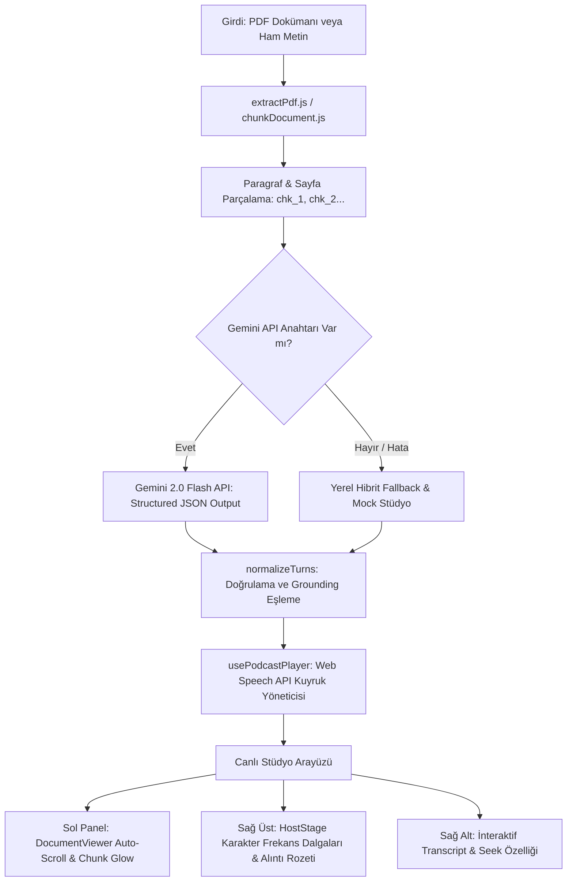

# 🎙️ HaberOdası AI (Resonote TR)

> **NotebookLM "Audio Overview" Klonu & Canlı Kaynak Doğrulamalı (Grounded) Yapay Zekâ Podcast Stüdyosu**

HaberOdası AI; karmaşık metin ve dokümanları monoton bir özet olmaktan çıkarıp, iki yapay zekâ sunucusunun karşılıklı tartıştığı, Türkçe konuşma dinamiklerine göre nefes alan ve konuştuğu her cümlenin belgedeki kanıtını canlı vurgulayan bir yeni nesil sesli medya platformudur.

[](https://react.dev/)
[](https://vitejs.dev/)
[](https://tailwindcss.com/)
[](https://ai.google.dev/)
[](https://developer.mozilla.org/en-US/docs/Web/API/Web_Speech_API)
[](https://oxc.rs/)

---

## ⚡ Sektörel "Deprem" ve Çıkış Noktası (The Paradigm Shift)

Yapay zekâ ekosistemi ve **Hacker News** gündemi, uzun süre boyunca kullanıcının soru sorup modelin maddeler halinde düz metin ürettiği standart chatbot arayüzlerine sıkışmıştı. 

Bu ezberi bozan ve sektörde **deprem etkisi yaratan kırılma**, Google'ın **NotebookLM "Audio Overview / Deep Dive"** teknolojisiyle gerçekleşti:
* **Eski Paradigma:** Metni al, 3 madde halinde özetle ve ekrana yaz.
* **Yeni Paradigma:** Metni derinlemesine anla, aralarında diyalektik bir ilişki olan iki farklı AI karakter (sunucu) yarat; birbirlerinin sözünü kestikleri, onayladıkları ve gerçek bir radyo stüdyosundaymış gibi tartıştıkları dinamik bir ses akışına dönüştür.

Bu gelişme, **Y Combinator RFS (Request for Startups)** listelerinde yer alan *"Voice Agents with Natural Latency"*, *"Generative Media"* ve *"Explainable AI / Grounded Interfaces"* başlıklarının somut bir kanıtı oldu.

---

## 🚀 Standart Klonun Ötesinde: 100+ Puanlık İnovasyonlarımız

Piyasadaki standart klon projeleri genellikle metni sırayla okuyan iki robotik TTS (Text-to-Speech) sesinden ve basit bir diyalog çıktısından ibarettir (85 puan tabakası). 

**HaberOdası AI**, bu yapıyı kırarak projeyi bir üst seviyeye taşıyan 3 temel mühendislik inovasyonu barındırır:

### 1. 🎯 Canlı Kaynak Doğrulama & Senkronize Vurgu (Live Citation Grounding)
* **Problem:** Yapay zekâ podcast sunucuları konudan sapabilir veya halüsinasyon görebilir; dinleyici bilginin kaynağını bilemez.
* **Bizim Çözümümüz:** Üretilen her konuşma satırı (`DialogueTurn`), kaynak dokümandaki `sourceChunkId`, sayfa numarası ve doğrudan alıntı (`excerpt`) ile sıkı sıkıya eşleştirilir.
* **Canlı UI Etkileşimi:** Ses çalarken, sol ekrandaki doküman otomatik olarak ilgili paragrafa kayar (`auto-scroll`) ve konuşulan kanıt metni canlı olarak vurgulanır (`visual glow/pulse`).

### 2. 🗣️ Türkçe Konuşma Dinamikleri & Araya Girme Motoru (Interjection Engine)
* **Problem:** Standart ses motorları satır bitince durur, sıra tabanlı okur ve samimiyetten uzaktır.
* **Bizim Çözümümüz:** 
  * Sunucu A (*Deniz - Meraklı, sorgulayan moderatör*) ve Sunucu B (*Barış - Veri odaklı analist*) olmak üzere iki zıt ses karakteri kurgulandı.
  * Türkçeye özgü doğal dolgu kelimeleri, onaylama sesleri (*"kesinlikle", "bir saniye ama", "hı-hım", "aynen öyle"*) ve mikro bekleme süreleri (`pauseAfterMs`) algoritmaya dahil edildi.

### 3. 🎛️ Çift Yayın Modu (Dual-Tone Architecture)
* Kullanıcı tek bir tıklamayla podcast'in üslubunu değiştirebilir:
  * **Akademik & Analitik Mod:** Terminolojiye sadık, metodolojik ve derinlemesine tartışma dili.
  * **Kahve Sohbeti / Samimi Mod:** Karmaşık konuları gündelik metaforlarla basitleştiren, esprili ve akıcı sokak dili.

---

## 🛠️ Mimari ve Veri Modeli

Sistem, üretilen her diyaloğu deterministik bir JSON şemasına zorlar:

```typescript
interface DialogueTurn {
  id: string;
  speaker: "hostA" | "hostB";
  speakerName: string;
  text: string;
  emotion: "curious" | "insightful" | "skeptical" | "enthusiastic" | "humorous";
  interjectionType?: "interruption" | "agreement" | "pivot";
  pauseAfterMs: number;
  grounding: {
    sourceChunkId: string;
    pageNumber: number;
    excerpt: string;
  };
}
```

### 🧩 Uçtan Uca Sistem Akışı (System Architecture)



---

## 🎭 Sunucu Profilleri ve Ses Kimlikleri

| Sunucu | Karakter Rolü | Ton & Dinamik | Web Speech Parametreleri | Tipik Kalıplar |
| :--- | :--- | :--- | :--- | :--- |
| **Deniz (Host A)** | Meraklı Moderatör, Dinleyici Köprüsü | Meraklı, sorgulayan, şaşıran, hızlandıran | `pitch: 1.12` / `rate: 1.06` (Kadın vokal öncelikli) | *"Bir saniye ama...", "Hı-hım", "Nasıl yani?", "Çok ilginç..."* |
| **Barış (Host B)** | Veri Odaklı Analist, Derin Dalıcı | Sakin, analitik, bağlam kuran, temkinli | `pitch: 0.86` / `rate: 0.92` (Erkek/Bariton vokal öncelikli) | *"Kesinlikle", "Aslında nüans şu...", "Kaynağa bakarsak...", "Aynen öyle"* |

---

## 💻 Kullanılan Teknolojiler ve Kütüphaneler

### 1. Modern Ön Yüz Çekirdeği
* **[React 19](https://react.dev/)**: En güncel React çekirdeği ile reaktif durum yönetimi ve bileşen mimarisi.
* **[Vite 8](https://vitejs.dev/)**: Ultra hızlı HMR (Hot Module Replacement) geliştirme ortamı ve optimize edilmiş üretim derlemesi.
* **[Tailwind CSS v4](https://tailwindcss.com/)**: CSS `@theme` değişkenleriyle özel renk paleti (`ink`, `panel`, `gold`, `mint`, `paper`), cam morfizmleri ve `chunk-glow` animasyonları.
* **[Lucide React](https://lucide.dev/)**: Modern radyo stüdyosu kontrolleri ve durum ikonları.

### 2. Doküman ve Yapay Zekâ Motoru
* **[PDF.js (`pdfjs-dist`)](https://mozilla.github.io/pdf.js/)**: İstemci tarafında sunucusuz (client-side) PDF ayrıştırma ve sayfa bazlı metin çıkarımı.
* **[Google Gemini API (`gemini-2.0-flash`)](https://ai.google.dev/)**: Yapılandırılmış JSON şeması (`response_mime_type: "application/json"`) ile sıfır halüsinasyonlu diyalog ve alıntı eşleme.
* **Gelişmiş Fallback Sistemi (`localScript.js` & `mockStudio.js`)**: API anahtarı girilmese veya kota aşılsa dahi dokümandan akıllıca diyalog sentezleyebilen yerel kural motoru.

### 3. Ses ve Canlı Senkronizasyon
* **[Web Speech API (`SpeechSynthesis`)](https://developer.mozilla.org/en-US/docs/Web/API/Web_Speech_API)**: Harici ağır ses kütüphanelerine ihtiyaç duymadan tarayıcının yerel Türkçe ses motorlarını dinamik perde (`pitch`) ve hız (`rate`) modülasyonuyla çalıştırma.
* **Akıllı Mikro-Gecikme Yönetimi (`pauseAfterMs`)**: Cümle aralarında doğal nefes alma ve düşünme aralıkları sağlayan asenkron zamanlayıcı mimarisi.

### 4. Kod Kalitesi
* **[Oxlint](https://oxc.rs/)**: Rust tabanlı ultra hızlı JavaScript/JSX statik kod analizi.

---

## 📂 Proje Dizin Yapısı

```plaintext
ResonoteTR/
├── public/                 # Statik web varlıkları
├── src/
│   ├── assets/             # Görseller ve medya
│   ├── components/         # Stüdyo UI Bileşenleri
│   │   ├── ControlBar.jsx     # Dosya yükleme, ton seçimi, API girişi ve playback kontrolleri
│   │   ├── DocumentViewer.jsx # Canlı kayan kaynak doküman ve parlayan (glow) bloklar
│   │   ├── HostStage.jsx      # Deniz & Barış animasyonlu avatarları ve ses dalgaları
│   │   └── Transcript.jsx     # Tıklanabilir, etkileşimli podcast diyalog dökümü
│   ├── hooks/
│   │   └── usePodcastPlayer.js # Web Speech API kuyruk, duraklatma ve alıntı senkronizasyon kancası
│   ├── lib/
│   │   ├── chunkDocument.js    # Metinleri anlamsal bloklara (chunk) bölen algoritma
│   │   ├── extractPdf.js       # PDF.js istemci tarafı metin çıkarma fonksiyonu
│   │   ├── gemini.js           # Gemini 2.0 Flash entegrasyonu ve hata yönetimi
│   │   ├── localScript.js      # API anahtarsız durumlarda çalışan yerel diyalog sentezleyici
│   │   ├── mockStudio.js       # Hazır Akdeniz tarımı örnek senaryosu ve doğrulanmış chunk verisi
│   │   └── promptTemplates.js  # Akademik ve Samimi mod sistem komutları & JSON şemaları
│   ├── App.jsx             # Ana stüdyo yerleşimi ve reaktif durum akışı
│   ├── index.css           # Tailwind v4 tema tanımlamaları, glow ve dalga animasyonları
│   └── main.jsx            # React 19 kök başlatıcı
├── .env.example            # Örnek ortam değişkenleri şablonu
├── package.json            # Bağımlılıklar ve npm scriptleri
├── vite.config.js          # Vite eklenti ve derleme yapılandırması
└── README.md               # Detaylı proje dokümantasyonu
```

---

## ⚙️ Kurulum ve Yerel Çalıştırma

Projeyi yerel ortamınızda çalıştırmak için aşağıdaki adımları sırasıyla uygulayabilirsiniz:

### 1. Depoyu Klonlayın
```bash
git clone https://github.com/kullanici-adiniz/ResonoteTR.git
cd ResonoteTR
```

### 2. Bağımlılıkları Yükleyin
Proje **Node.js 18+** sürümünü gerektirir:
```bash
npm install
```

### 3. Ortam Değişkenlerini Ayarlayın (İsteğe Bağlı)
Kök dizindeki `.env.example` dosyasını `.env` olarak kopyalayın:
```bash
cp .env.example .env
```
Dosya içerisine Gemini API anahtarınızı ekleyin:
```env
VITE_GEMINI_API_KEY=AIzaSy...
```

> 💡 **Not:** API anahtarını `.env` dosyasına yazmak zorunda değilsiniz. Uygulama arayüzündeki üst kontrol çubuğundan dilediğiniz zaman API anahtarınızı yapıştırabilir ya da **hiç anahtar girmeden** yerel sentezleyici / hazır Akdeniz senaryosu ile anında çalıştırabilirsiniz.

### 4. Geliştirme Sunucusunu Başlatın
```bash
npm run dev
```
Terminalde belirtilen yerel adresi (varsayılan: `http://localhost:5173`) tarayıcınızda açın.

---

## 🛠️ Kullanılabilir Komutlar (NPM Scripts)

| Komut | Açıklama |
| :--- | :--- |
| `npm run dev` | Vite geliştirme sunucusunu başlatır (HMR aktif). |
| `npm run build` | Üretim (production) için optimize edilmiş statik dosyaları `dist/` klasörüne derler. |
| `npm run preview` | Derlenen `dist/` paketini yerel ortamda önizler. |
| `npm run lint` | Oxlint ile projede statik kod analizi ve linter denetimi yapar. |

---

## 🖥️ Kullanım Rehberi

1. **Örnek Senaryo ile Hemen Başlama:**
   * Sayfa ilk açıldığında yerleşik *"Akdeniz Tarımında Su Güvenliği"* dokümanı ve diyaloğu hazır gelir.
   * Kontrol çubuğundaki **Oynat (Play)** butonuna basarak doğrudan deneyimleyebilirsiniz.
2. **Kendi Belgenizi Yükleme:**
   * **PDF / Metin** butonuna tıklayarak bilgisayarınızdan bir `.pdf`, `.txt` veya `.md` dosyası seçin.
   * Veya **Metin Yapıştır** butonunu kullanarak uzun bir makaleyi yapıştırıp parçalara bölün.
3. **Yayın Modunu Seçme:**
   * **Akademik:** Kavramsal, metodolojik ve analitik derinlemesine tartışma.
   * **Samimi:** Günlük sokak dili, esprili ve samimi kahve sohbeti.
4. **Deep Dive Üretimi:**
   * Gemini API anahtarınız girilmişse **Deep Dive Üret** butonuna tıklayın. Model, doküman parçalarınızı analiz edip kaynak alıntılarıyla bezeli bir diyalog oluşturur.
   * API anahtarınız yoksa akıllı yerel motor devreye girerek belgenizi anında seslendirilebilir bir senaryoya dönüştürür.
5. **Dinleme ve Canlı Takip:**
   * Oynatma esnasında Deniz veya Barış konuştukça sol taraftaki doküman ilgili bölüme otomatik odaklanır ve sarı altın (`gold glow`) parlamayla alıntıyı gösterir.
   * Sağ taraftaki **Transkript** üzerinden herhangi bir satıra tıklayarak podcast'i dilediğiniz noktaya anında atlatabilirsiniz (`seek`).

---

## 🎧 Tarayıcı Uyumluluğu ve Ses İpuçları

* **Önerilen Tarayıcılar:** En doğal Türkçe TTS deneyimi için **Google Chrome** veya **Microsoft Edge** önerilir (Bu tarayıcılar yerleşik yüksek kaliteli Türkçe doğal ses paketleri barındırır).
* **Ses Seçimi:** Sistem; Deniz için kadın tonlarını (`Filiz`, `Yelda`, `Zehra`), Barış için ise erkek/bariton tonlarını (`Tolga`, `Emre`) otomatik olarak algılar ve eşleştirir.

---

## 🤝 Katkıda Bulunma (Contributing)

1. Projeyi Fork'layın (`Fork`).
2. Yeni bir özellik dalı oluşturun (`git checkout -b feature/YeniOzellik`).
3. Değişikliklerinizi commit'leyin (`git commit -m 'feat: Yeni özellik eklendi'`).
4. Dalınıza push yapın (`git push origin feature/YeniOzellik`).
5. Bir **Pull Request** açın.

---

## 📄 Lisans

Bu proje **MIT Lisansı** altında lisanslanmıştır. Detaylar için ilgili lisans dosyasına göz atabilirsiniz.
